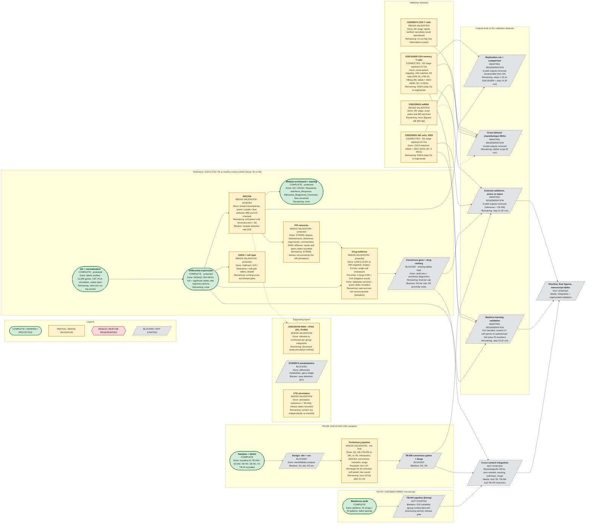

# TB Systems-Biology Pipeline — GSE99374, GSE222001, GSE161829, GSE229020, GSE114192

A network-medicine project: computational drug-repurposing
approaches for tuberculosis (drug-resistant, latent, drug-susceptible TB).

## Current status (15 Oct 2026; read first)

On 15 Oct the GSE161829 and GSE222001 DEG-stage outputs were replaced by runs of the corrected,
name-matching scripts (labels verified against GEO). Every output built on the old, mislabelled versions
(GSEA of both datasets, the GSE161829 replication run, step-14 comparison, cross-dataset UpSet, external and
ML validation) was removed and is awaiting regeneration; the previous versions remain in Git history.

| Layer | Status |
|---|---|
| Reference TB vs HC (GSE114192) | Complete. MM/GS re-verified from the WGCNA workspace. Drug tiers depend on proximity votes, although network proximity has 0 FDR-significant drugs (D5). |
| TB-DM (GSE114192/TB_DM) | **Preliminary.** Site confounding, sex, module selection and consensus scheme are pending (D1–D5, D13). Design record: `GSE114192/TB_DM/00_design/`, `00_sample_manifest.csv`, `00_contrast_plan.csv`, `00_design/`. |
| TB-HIV (GSE50834) | **Not started.** Readiness audit (`GSE50834/00_dataset_audit.txt`) found disease group confounded with array processing period (D10). |
| GSE222001 | **Corrected DEG stage (15 Oct).** 15/15 count columns matched to GEO by name; 5 Healthy / 5 Active / 5 Latent; 29 and 3 DEGs (Healthy vs Active / Latent). GSEA awaiting regeneration. NK cells, not whole blood. |
| GSE161829 | **Corrected DEG stage (15 Oct).** 106 columns matched to GEO by name; 21 post-treatment samples excluded, 85 kept (ATB 25, LTBI 40, TBneg 20); 50 and 3 DEGs (TBneg vs ATB / LTBI). GSEA and the TBneg_vs_ATB replication run awaiting regeneration. CD4 memory T cells. |
| Replication, cross-dataset, external validation, ML (steps 14, 21, 22, UpSet) | **Awaiting regeneration.** Old outputs used the mislabelled data and were removed. Step 22 now estimates the discovery AUC by nested cross-validation (D12). |
| GSE165709 RNA/ATAC | Supporting layer. No significant HC-vs-PLWH response difference. |
| ST000974 metabolomics | Case definition unverified (D7). |

Notes on the sections below:
- The replication statements in the step-14 section describe the removed outputs and will be replaced after regeneration.
- `reproducibility/PARAMETERS.md` and `comparisons/README.md` are regenerated by scripts; caveats are kept here instead.

### Workflow map

Status of each dataset and analysis stage (15 Oct 2026). Colour and shape both carry the status:
green rounded = complete, verified and protected; yellow rectangle = exists but needs validation;
red hexagon = invalid, must be regenerated; grey slanted = blocked or not started. Arrows point from
an input to the work that uses it; dotted arrows are supporting comparisons only. D-numbers refer to
the open methodological decisions below. Update the map whenever a stage changes status.



### Open methodological decisions

| ID | Decision | Evidence |
|---|---|---|
| D1 | TB-DM site handling: HC/DM only at SA+RO; Cramér's V 0.34. Options: SA+RO with `~ site + …` / all sites `~ site + group` / keep `~ group` with limitation. | `GSE114192/TB_DM/00_design/` §3, `00_design/design_identifiability.csv` |
| D2 | Sex covariate (not in GEO): ask authors / infer from XIST and Y genes / none | same file §4 |
| D3 | WGCNA module selection: the top-3 cap excludes strongly associated modules (TB-DM brown r 0.49, FDR 2e-7) | `*/10_wgcna_results/GSE114192_module_selection_comparison.csv` |
| D4 | Gene consensus tiers: "Low" includes 0-criteria genes; High set is sensitive to the 20% cut-off (Jaccard 0.45–0.47 at 10/30%) | `*/19_consensus/GSE114192_gene_*.csv` |
| D5 | Proximity in drug tiers: 0 drugs with FDR < 0.05, yet proximity votes decide 6/8 reference and 10/12 TB-DM High drugs | `*/19_consensus/GSE114192_drug_criteria_provenance_and_DRAFT_rules.csv`, `*/15_network_algorithms/*_withFDR.csv` |
| D6 | Scope: whether drug-resistant TB datasets are analysed in addition to latent and active TB | — |
| D7 | Role of metabolomics (ST000974), scRNA and GSE165709 as supporting layers | Known limitations below |
| D8 | Drug mechanism-of-action / latent-space prediction (later stage) | — |
| D10 | GSE50834 suitability (batch confounding) | `GSE50834/00_dataset_audit.txt` |
| D11 | **Decided 15 Oct:** corrected GSE222001 and GSE161829 outputs replace the mislabelled ones; dependent outputs are regenerated (pending) | audit CSVs in `GSE222001/02_metadata/`, `GSE161829/02_metadata/` |
| D12 | **Decided 15 Oct:** repeated nested CV with genes re-selected in each training fold (implemented in step 22, not yet run) | Known limitations below |
| D13 | TB-DM rerun design (after D1–D5; with consistent LFC shrinkage and logged soft power) | `GSE114192/TB_DM/00_contrast_plan.csv` |

## What this is

Two connected stages:

1. **DEG pipeline** (all 5 datasets): raw counts → DESeq2/limma DEG calling.
2. **Network-medicine pipeline**, configured per run in `scripts/wgcna_network/config.R`
   (pilot: GSE114192, Healthy_Control vs TB_Only, n = 82; replication: GSE161829, TBneg vs ATB, n = 45):
   WGCNA modules → enrichment → DEG×WGCNA integration → STRING PPI → combined network →
   iLINCS drug-reversal signature → drug targets (DGIdb) → network algorithms →
   final gene and drug tables, annotated with GSEA, per-drug pathways (Enrichr) and
   single-cell cell-type profiles.

GSE114192 was chosen as the pilot because it is the largest clean binary
TB-vs-Control comparison of the 5 datasets. GSE161829 (TBneg vs active TB) is the
replication run; step 14 compares the two. GSE222001, GSE99374 and GSE229020 are at the
DEG stage (GSEA is available for the gene-level ones).

| Dataset | Material and platform | Groups analysed (n) | Role |
|---|---|---|---|
| GSE114192 | whole blood, RNA-seq | Healthy_Control 36, TB_Only 46; TB-DM run adds TB_DM 61, DM_only 52 | reference (TB vs HC) and TB-DM |
| GSE161829 | memory CD4+ T cells, Smart-seq2 | TBneg 20, LTBI 40, ATB 25 (21 post-treatment samples excluded) | replication and validation |
| GSE222001 | NK cells, RNA-seq | Healthy 5, Latent 5, Active 5 | validation (low power) |
| GSE99374 | CD8+ T cells, RNA-seq | HC 19, LTBI 21 | early DEG analysis; sensitivity check |
| GSE229020 | NanoString miRNA panel | HC 4, Latent 6, drug-susceptible 6, drug-resistant 4 | miRNA DEG stage (limma) |
| GSE165709 | RNA-seq + ATAC-seq, Mtb-infected vs uninfected | HC 16 + 16, PLWH 20 + 20 (36 donors) | supporting RNA/chromatin layer |
| ST000974 | plasma metabolomics | 26 case vs 85 control (M06) | supporting layer (D7) |
| GSE50834 | PBMC, Illumina HT-12 v4 arrays | 44 arrays, 43 patients | TB-HIV (not started; D10) |

```
TB-DEG/
├── scripts/
│   ├── deg_pipeline/                 <- Stage 1 (run with working directory = scripts/deg_pipeline)
│   │   ├── 00_functions.R            shared: filtering, VST/PCA, DEG + volcano, etc.
│   │   ├── GSE99374_run.R, GSE222001_run.R, GSE161829_run.R, GSE114192_run.R
│   │   ├── GSE114192_comorbidity_run.R   TB-DM framework: four groups, pairwise contrasts + interaction
│   │   ├── GSE229020_miRNA_run.R     NanoString miRNA panel, not RNA-seq — uses limma
│   │   ├── sensitivity_check_no_outliers.R
│   │   └── 05_cross_dataset_upset.R  shared/unique DEGs across the gene-level datasets
│   ├── wgcna_network/                <- Stage 2, run in step order; works from any working directory
│   │   ├── config.R                           run presets (dataset, groups, DEG table, output folder)
│   │   ├── fix_input_dirs.R                   lets a run folder supply its own inputs (TB-DM)
│   │   ├── WGCNA_TBmodules_step1.R            module–trait correlation, top-3 modules, MM/GS
│   │   ├── WGCNA_remerge_test.R               diagnostic only: alternative merge thresholds
│   │   ├── WGCNA_TBmodules_step2_enrichment.R … WGCNA_compare_runs_step14.R   steps 2–14 (see below)
│   │   ├── WGCNA_consensus_priority_step15.R  consensus gene and drug ranking
│   │   ├── GSE165709_differential_step16.R, GSE165709_integration_step17.R, GSE165709_atac_geneset_step18.R
│   │   ├── metabolomics_step19.R, metabolomics_bridge_step20.R          ST000974 layer
│   │   ├── external_validation_step21.R, ml_validation_step22.R
│   │   ├── ctd_annotation_step23.R, figures_step24.R
│   │   └── GSE114192_interaction_gsea.R       GSEA on the TB x DM interaction coefficients
│   ├── checkpoint/                   Python helpers (no R needed): annotated DEG tables, WGCNA exports from
│   │                                 the saved workspace, proximity FDR, TB-DM design record, diagnostics
│   └── record_reproducibility.R      writes reproducibility/ (package versions, session, parameters)
├── GSE114192/                        reference run (HC vs TB) + TB_DM/ (TB-DM run, same numbered folders)
├── GSE161829/                        dataset level + TBneg_vs_ATB/ (replication run)
├── GSE222001/ GSE99374/ GSE229020/   DEG stage
├── GSE50834/                         TB-HIV readiness audit only (no analysis yet)
├── external_results/GSE165709/       RNA-seq + ATAC-seq results (steps 16–18)
├── comparisons/                      step-14 output, one folder per pair of runs (awaiting regeneration)
├── cross_dataset_comparison/         05_cross_dataset_upset.R output (awaiting regeneration)
├── reproducibility/                  versions, session, parameters, diagnostics summaries, figure inventory
├── external_data/                    (NOT in git — see "Single-cell data" below)
├── PACKAGES.md                       every package, install commands, known problems
└── .gitignore
```

Steps 2–14 in `scripts/wgcna_network/`: enrichment (2), DEG × WGCNA (3), STRING per module (4), combined
network (5), iLINCS signature (6) and query (7), DGIdb targets (8), network algorithms (9), final tables (10),
GSEA (11), Enrichr per drug (12), single-cell profile (13), run comparison (14).

Per-dataset folders: `01_raw_counts` → `02_metadata` → `03_filtered_counts` → `04_normalized` →
`05_sample_correlation` → `06_deg_results` → `07_significant_degs` → [`08_shared_unique_degs`] →
`09_wgcna_input` → `figures/`. Network runs add `10_wgcna_results` → `11_module_enrichment` →
`12_string_ppi` → `13_ilincs_signature` → `14_drug_targets` → `15_network_algorithms` →
`16_final_tables` → `17_gsea` → `17_pathway_annotation` → `18_singlecell` → `19_consensus`. Both GSE114192
runs also have `22_metabolite_gene_bridge` → `23_external_validation` → `24_ml_validation` →
`25_ctd_annotation` → `figures_manuscript/`; the reference run adds `21_metabolomics`, the TB-DM run
`17_gsea_interaction`. The replication run writes its 10–19
folders into `GSE161829/TBneg_vs_ATB/`, the TB-DM run into `GSE114192/TB_DM/`; GSEA results (step 11) are
always in `<dataset>/17_gsea/`, one set of files per comparison. Files starting with `00_` are design or
audit records (TB-DM design, GSE50834 audit); label audits for GSE161829 and GSE222001 are in their
`02_metadata/` folders.

Raw GEO downloads (`01_raw_counts/**.gz` etc.) are not tracked; the `*_run.R` scripts re-download them.

## How to run

**Stage 1.** Install packages from `PACKAGES.md`, set the working directory to `scripts/deg_pipeline`
(RStudio: Session → Set Working Directory → To Source File Location) and run each `GSE*_run.R`.
GEO's `characteristics_ch1` naming differs between series, and each raw-count supplementary file was
identified by hand; the scripts mark where. DEG calls: DESeq2 Wald test vs control, apeglm shrinkage,
significance = padj < 0.05 & |log2FC| ≥ 1 (limma for the GSE229020 miRNA panel). WGCNA input is the full
VST matrix.

**Stage 2.** Choose the run in `scripts/wgcna_network/config.R` (`ACTIVE_RUN`, or the environment
variable `TB_RUN`, e.g. `TB_RUN=GSE114192_TB Rscript WGCNA_TBmodules_step1.R`). Each preset sets the
dataset, the control and case groups (other samples, e.g. LTBI, are left out), the DEG table and the
output folder; a new dataset or comparison only needs a new preset. Run the scripts with `Rscript` or
RStudio's Source button so a script stops at its first error. Then run the steps in order (the remerge
test is optional; step 14 compares two finished runs). Steps 4, 5,
7, 8 and 12 call web services (STRING, iLINCS, DGIdb, Enrichr), so they need internet and can be slow;
step 12 caches every drug and can simply be re-run after an interruption. After steps 12 and 13,
re-run step 10 so the final drug table picks up their columns.

**Single-cell data (step 13).** Uses the 4-week *M. tuberculosis* granuloma dataset (Broad Single Cell
Portal SCP1749) as packaged in
[RajarshiRay25/Single-Cell-Analysis---Tuberculosis](https://github.com/RajarshiRay25/Single-Cell-Analysis---Tuberculosis).
Download `data files.zip` from that repository and put `4Week_countsmatrix.mtx`, `4Week_features.tsv`,
`4Week_barcodes.tsv` and `metadata.txt` into `external_data/SCP1749/` (175 MB, git-ignored).

## Current results (GSE114192)

- **Modules** (top 3 by |correlation| with TB): **green** r = +0.73, interferon/antiviral response;
  **purple** r = −0.70, ribosome biogenesis / chromatin; **blue** r = −0.63, 1,377 genes, no significant
  over-representation.
- **Blue explained by GSEA + single-cell:** the network is unsigned, and blue mixes lymphocyte genes that
  are lower in TB (naive T-cell sets, e.g. HAY_BONE_MARROW_NAIVE_T_CELL NES −2.59) with myeloid genes
  that are higher in TB. In the granuloma single-cell data, blue genes lower in TB are expressed mostly
  in T/B cells (mean share T 18.7 %, B 11.3 %) and blue genes higher in TB mostly in macrophages and
  neutrophils (13.8 %, 11.8 %), against 9.1 % expected. Bulk data cannot tell fewer cells from lower
  expression per cell.
- **Strongest pathways (GSEA Hallmark):** IFN-γ response NES +2.72, IFN-α response +2.69.
- **Disease genes:** 188 DEG–WGCNA overlap genes (143 green, 45 blue, 0 purple). Networks, RWR, diffusion and
  the final gene table use the complete selected-module set of 1,946 genes; the two sets are kept separate. **Hubs:** STAT1 (green), PARP1 (purple), MYC (blue).
- **Drugs:** 4,251 iLINCS reversal compounds → 395 with a DGIdb target in the TB network. Final drug
  table: 367 with a reversal score, 352 with Enrichr pathways (43 have < 3 known targets), 244 with a
  cell-type profile.
- **Network proximity is not informative here:** no drug's targets are closer to the disease genes than
  degree-matched random targets (mean Z ≈ 0; 395 drugs, 0 with BH-FDR < 0.05). Step 15 nevertheless counts
  proximity as up to two consensus criteria, so the drug tiers depend on it (see D5).

## Replication (GSE161829, TBneg vs ATB) — step 14

**Superseded.** These results came from the mislabelled GSE161829 outputs (7 of 85 samples in the wrong group;
see Known limitations). The outputs were removed on 15 Oct and are being regenerated; the text below is kept only
until the regenerated comparison replaces it.

- **Pathways replicate:** 14 Hallmark sets are significant with the same sign in both runs, led by
  IFN-γ response (NES +2.72 / +2.49) and IFN-α response (+2.69 / +2.51), with IL6-JAK-STAT3, complement,
  allograft rejection, oxidative phosphorylation and mTORC1; 86 cell-type and 76 Reactome sets also
  replicate. E2F targets, G2M checkpoint, MYC targets V2 and mitotic spindle go in opposite directions
  (lower in the pilot, higher in GSE161829).
- **Genes and modules replicate only weakly:** log2FC correlation 0.22; 5 genes significant in both
  (0.6 expected by chance), all in the same direction; module overlaps are small.
- **Drug candidates do not replicate:** reversal hits overlap no more than expected by chance (350 vs
  380), and the same LINCS signatures score in opposite directions (Spearman −0.42). The two TB_UP
  signatures share only STAT1, PSME2 and UBE2L6, and about half of the 18-gene GSE161829 signature is
  cell-cycle genes (the pilot's has none), which most likely drives the disagreement.
- GSE161829 has very few L1000 genes going down, so its iLINCS query used TB_UP only; the comparison
  therefore uses UP-only results for both runs.

## Known limitations

- Replication so far covers one second cohort; drug candidates are not yet reproducible across cohorts.
- DGIdb target lists include drug-metabolising enzymes and transporters (CYPs, SLC, ABC), so roughly
  15 % of the top KEGG/Reactome labels per drug are ADME-type rather than mechanism-of-action.
- The single-cell reference is macaque lung granuloma (2 animals, coarse labels), not human blood;
  read it as "which immune cell type a gene belongs to", not as blood composition. Its p-values are
  descriptive only.

- **Sample-label errors (confirmed against GEO `!Sample_description`, 14 Oct 2026; corrected 15 Oct).** The
  corrected scripts match count columns to GEO samples by name and stop on any mismatch. Their outputs replaced
  the old ones after an independent check: labels agree with GEO (GSE161829 85/85, GSE222001 15/15); GSE222001
  raw counts are unchanged; old vs new DEGs: GSE161829 TBneg_vs_ATB 50 vs 50 (42 shared, log2FC r 0.92),
  TBneg_vs_LTBI 0 vs 3; GSE222001 Healthy_vs_Active 46 vs 29 (8 shared, r 0.49), Healthy_vs_Latent 2 vs 3 (r −0.48).
  What was wrong:
  - GSE222001: the existing outputs come from a version of `scripts/deg_pipeline/GSE222001_run.R` that
    assigned GEO labels to count columns by position. All 5 `NC` (healthy) samples are labelled Latent and all 5 `LTBI` samples Healthy, so
    "Healthy_vs_Active" is really LTBI vs Active and "Healthy_vs_Latent" is sign-reversed LTBI vs Healthy.
    The same script also named a count file (`GSE222001_count.txt`) that GEO supplies only gzipped; it now reads
    `GSE222001_count.txt.gz`. Audit: `GSE222001/02_metadata/GSE222001_sample_label_audit.csv`.
  - GSE161829: the existing outputs come from a version of `scripts/deg_pipeline/GSE161829_run.R` that renamed
    `SampleN_CD4m` columns to GSMs by position, but GEO order differs at positions 74–101. 28 GSM columns held
    another sample's counts: for 7 the counts came from a sample of a different group (these change the DEG
    results), for 21 from another sample of the same group (no effect on DEG statistics, but wrong sample-level
    labels). Group sizes were unchanged (20/40/25). Audit: `GSE161829/02_metadata/GSE161829_count_column_to_GSM_audit.csv`.
  - Removed on 15 Oct and awaiting regeneration: `GSE161829/17_gsea/`, `GSE222001/17_gsea/`, `GSE161829/TBneg_vs_ATB/`,
    `comparisons/`, `cross_dataset_comparison/`, and `23_external_validation/` and `24_ml_validation/` in both GSE114192 runs.
    The positional fallback in `GSE114192_run.R` and `GSE114192_comorbidity_run.R` (never triggered: columns are
    GSM IDs) was replaced by an error on 15 Oct. GSE99374 labels match the authors' sample names (40/40).
- **Cell types of the validation sets:** GSE161829 = memory CD4+ T cells, GSE222001 = NK cells (n = 5 per
  group), GSE99374 = CD8+ T cells. Discovery (GSE114192) is whole blood, so non-replication may reflect cell type.
- **ML validation (step 22):** the earlier discovery AUCs (signature 0.975, elastic net 0.894) were in-sample,
  because the genes and lambda were chosen on the same 82 samples. Step 22 now also runs a repeated nested CV
  (5 folds × 10 repeats, seed 42): in each outer training fold the genes are re-selected (Welch t-test, same panel
  size), standardised with training-fold parameters and the elastic-net lambda is chosen by inner CV before the
  held-out fold is predicted. The in-sample rows are kept but labelled optimistic; external datasets stay hold-outs.
- **Network proximity:** BH-FDR added in `*/15_network_algorithms/GSE114192_NetworkProximity_withFDR.csv`
  (new file; originals unchanged). Reference: 395 drugs, 4 nominal p < 0.05, 0 FDR < 0.05; TB-DM: 432, 3, 0.
- **WGCNA soft power was not saved by the existing runs.** Reconstructed from the saved figures (approximate,
  ±0.01 R²; `reproducibility/WGCNA_soft_threshold_reconstructed_from_figure.csv`): reference R² first ≥ 0.85
  at power 16; TB-DM never reaches 0.85, so the fallback power 6 was most likely used (R² ≈ 0.77). Since 15 Oct,
  `WGCNA_TBmodules_step1.R` writes `<ACC>_WGCNA_soft_threshold.csv` (fit table and power used) on each run.
- **WGCNA exports added from the saved workspace** (no rerun): `*_ModuleEigengenes_from_workspace.csv` and
  `*_module_merging_summary.csv` in both `10_wgcna_results/` folders (reference 52 → 18 modules; TB-DM 46 → 29).
- **DEG tables:** `*_annotated.csv` copies add gene symbol, direction, comparison and LFC type. In the existing
  (preliminary) TB-DM tables only the primary contrast is apeglm-shrunk. For the TB-DM rerun,
  `GSE114192_comorbidity_run.R` now makes each contrast's control the reference level so every contrast is
  apeglm-shrunk, and `run_deg()` writes an `lfc_type` column and warns instead of silently skipping shrinkage.
- **GSEA location:** `WGCNA_GSEA_step11.R` writes every comparison to the dataset-level folder, so the four
  TB-DM GSEA comparisons are in `GSE114192/17_gsea/` (not `GSE114192/TB_DM/`). Steps 14 and 24 read them there.
- **GSE165709:** HC infected vs uninfected: 2,259 genes and 238 ATAC regions at padj < 0.05; PLWH: 669 genes and
  0 regions; formal PLWH-vs-HC response difference: 0 genes, 0 regions. "Weaker response in PLWH" is
  descriptive only. The 5 RNA+ATAC-supported genes (DDX60, LAP3, OTOF, STOML1, FOXO1) are supported in HC only.
- **ST000974 (metabolomics):** plasma; analysis uses the M06 timepoint (26 case vs 85 control; 9 of 699
  metabolites padj < 0.05). What "case" means is not verified (possibly TB progressors rather than active
  TB), and whether REGION/GENDER adjustment ran depends on limma being installed. No diabetes or HIV variable.
- **CTD:** annotation only. The Medium-tier count (366 vs 373) differs because 7 genes have no gene symbol.
  The bulk files' report dates (29 Sep 2026) are in `reproducibility/external_resource_versions.csv`.
- **Figures:** PNGs carry no embedded DPI tag, so resolution is judged from pixel size
  (`reproducibility/FIGURE_INVENTORY.csv`, from `scripts/checkpoint/figure_inventory.py`). All scripts now set
  600 dpi; the GSE99374 and GSE229020 figures were made at 300 dpi and are 600 dpi only after a rerun.
- **Versions not recorded** in `reproducibility/package_versions.csv` (generated before steps 22–23 existed):
  apeglm, glmnet, data.table. `scripts/record_reproducibility.R` now also detects apeglm; rerun it to update.
- **GSE229020 script paths:** `GSE229020_miRNA_run.R` pointed at `01_raw_data/` and `03_filtered/`, which do not
  exist; corrected on 15 Oct to the dataset's `01_raw_counts/` and `03_filtered_counts/` (not rerun).
- **External resources:** STRING, iLINCS, DGIdb, Enrichr and KEGG are queried live and not version-pinned;
  `reproducibility/external_resource_versions.csv` (from `scripts/checkpoint/external_resource_versions.py`)
  records the libraries, package versions, file report dates and the date each result was first committed.
